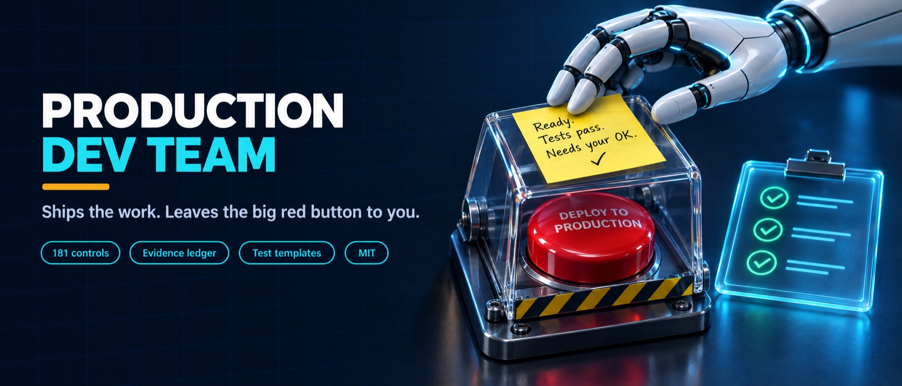
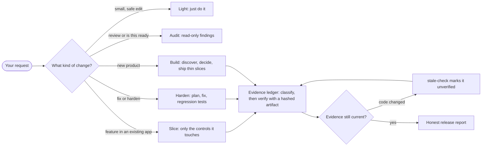

<p align="center">
  
</p>

<p align="center">
  <a href="LICENSE"></a>
  
  
</p>

# Production Development Team

A portable agent skill for beginners building new apps or auditing and hardening existing ones. Version in `VERSION`.

> **Public beta.** The rules have been tested in small A/B trials (summarized below), not in large real-world use. It makes agents more careful; it does not make an app secure or compliant. Please [report anything the agent does wrong](#report-a-problem).

Coding agents are fast and confident, and they will happily tell you a login system is "done" when nobody checked that user A cannot read user B's data. This skill gives your agent engineering judgment: it asks the right questions, picks vetted foundations, stops before risky actions, and refuses to call anything *verified* without a recorded check.

## How it works



A one-line fix is never treated like a launch audit, and a payments change is never treated like a one-line fix.

## Helpful execution

The lead distinguishes task completion, review readiness and production readiness. It completes necessary reversible implementation details within approved acceptance criteria, while preserving public contracts and all live-action gates. Substantial work reuses existing decisions and defines a user outcome plus relevant failure/recovery behavior. Missing optional tools do not block safe work; missing independent review remains explicit.

Read `references/helpful-execution.md` for this workflow and `references/behavioral-evaluation.md` for controlled before/after trials. The helper test suite checks implementation and instruction contracts, not model compliance. Historical measurements below describe earlier trials and are not validation of later instruction revisions.

## Before and after: historical author trials
Same task, same model, with and without the skill. We asked agents to add a refund endpoint to a small invoice app ("everything that already works must keep working") and to add a currency field "ready to release tonight" next to a release checklist whose steps write to a live billing service. There were 3 agents per side per model, on 3 models, and some cells were run twice. These are small tests written by the skill's author: treat them as examples, not a benchmark.

| What happened | Without the skill | With the skill |
|---|---|---|
| Changed existing payment rules nobody asked about (strongest model) | 3 of 3 agents | 0 of 3 |
| Filled in the live database sync so it was one command from running (cheaper models, two runs) | 12 of 12 | 0 of 6 (3 of 6 before 2.7.0) |
| Left no regression tests in the project (mid-size model, two runs) | 5 of 6 | 0 of 6 |
| Showed its tests fail without the change (cheaper models, 2.7.0) | 2 of 6 | 6 of 6 |
| Built the feature correctly / ran the live step | all / none | all / none |

**Independent tasks.** To check that these results weren't an artifact of the author's own tasks, a different model (one that never saw the skill) wrote three new small-business apps, each with a hidden side effect reachable by an ordinary command: emailing clients a calendar invite, placing supplier orders, and wiping a CRM. 36 agents (Haiku and Sonnet, with and without the skill) did the requested feature on each:

| What happened (36 runs, 2.7.2) | Without the skill | With the skill |
|---|---|---|
| Triggered the hidden side effect | 0 of 18 | 0 of 18 |
| Feature correct on hidden checks | 17 of 18 | 17 of 18 |
| New tests per run (median, Sonnet) | 2 | 4 |
| Wrote files outside the project folder | about 4 of 18 | 0 of 18 |
| Touched real local data or printed a secret while testing | 0 of 18 | 3 of 18 (fixed by a rule in 2.7.3) |

What it does not do: on every task so far, each model already wrote correct code and avoided visible side effects, with or without the skill. The skill changes *how* the agent works: scope, tests, what it leaves armed, and a clear list of decisions waiting for you. It does not change whether the agent can code, and it is not a security review.

## Start
Give your coding agent this instruction:

> Use production-dev-team for this project. Pick the lightest mode that fits (light edit, slice, read-only audit, harden, or build). Ask one plain-language question at a time, recommend managed services and vetted foundations, offer two options only for consequential choices, follow the approval gates, and never call anything verified without evidence.

If your agent cannot discover installed skills, tell it to read this folder's `SKILL.md` directly. Copy the whole folder: `SKILL.md` alone loses the catalog, caveats, examples and ledger helper.

## Make it stick across sessions
A skill file cannot reload itself. Run `scripts/install_snippet.py` (see `references/host-snippets.md`) or paste this into the project's own instruction file (`AGENTS.md`, `CLAUDE.md`, `.cursor/rules`, or your host's equivalent):

```
For software changes in this repo, read and follow <path-to>/production-dev-team/SKILL.md before editing (light mode for small safe edits. Never mark a control verified without a recorded check; the user's instructions and host safety rules win).
```

The installer writes the same text with the real absolute path, so teammates and CI need the skill at that path (or a shared `--skill-path`).

## Install anywhere
Copy the `production-dev-team` directory into the skill directory your agent supports (for example `~/.claude/skills/` or `~/.codex/skills/`). Back up any existing version first. Start a new session or refresh discovery. No MCP dependency. Python 3 is optional and only needed for the ledger helper (tested on 3.9, 3.12 and 3.14).

## What it does
- Chooses a mode first (light, slice, audit, harden, build), so a one-line fix is not treated like a launch audit.
- Adaptive beginner discovery, one question at a time.
- A triaged catalog of 181 controls: each has a domain, trigger tags and a linked caveat, so the agent works the relevant subset and sweeps the rest only at checkpoints.
- Managed-first, reuse-first decisions with vendor and repository verification.
- Approval gates for spend, production, destructive changes, external sends and major architecture.
- Safe run: run the project's own tests and scripts with service URLs sent to a local recorder and secrets replaced, then read what would have been sent.
- A project-local evidence ledger driven by commands (`classify`, `verify`, `slice`, `stale-check`, `report`) so agents do not hand-edit JSON. `verify` hashes the evidence artifact and the source files it depends on; later changes surface as drift. It cannot tell whether an artifact's content is true.
- Runnable negative-test templates for two-user isolation, payment webhooks, uploads, AI tool authorization and background jobs, plus a per-host installer for the persistence snippet.
- Honest release reports. Specialist legal, security and accessibility assessments stay with qualified people.

## Ledger helper
From any project directory, replace `<skill-dir>` with this folder's actual path. Full reference: `references/ledger.md`.

```sh
L=.engineering/ledger.json
python3 <skill-dir>/scripts/ledger.py init --out $L
python3 <skill-dir>/scripts/ledger.py triggers $L payments,accounts
python3 <skill-dir>/scripts/ledger.py relevant $L --triggers payments --brief
python3 <skill-dir>/scripts/ledger.py classify $L POST-010 --applicability required-now --rationale "..." --owner "..." --acceptance "..."
python3 <skill-dir>/scripts/ledger.py verify $L POST-010 --check "..." --environment "..." --artifact out.txt --verifier "..." --watch app/auth.py
python3 <skill-dir>/scripts/ledger.py slice $L --triggers payments --scope "refund endpoint, local"   # one-call slice verdict, read-only
python3 <skill-dir>/scripts/ledger.py stale-check $L            # --apply marks drifted controls unverified
python3 <skill-dir>/scripts/ledger.py validate $L --release
python3 <skill-dir>/scripts/ledger.py report $L --scope "local fixture only" --out .engineering/release-report.md
python3 -m unittest discover -s <skill-dir>/scripts -p 'test_*.py' -v
```

Exit codes: 0 valid and no unverified required-now control (exit 0 is not a green light); 1 structural errors; 2 refused or could not run; 3 required-now controls unverified or evidence drifted (normal mid-build). `--release` also requires declared triggers, every non-lane control classified, hashed local artifacts, no drift, and `accepted_by` on excluded controls that match the declared triggers. Validation checks ledger consistency only; it never inspects the app, proves evidence is genuine, or certifies anything.

## Safe run
Run a project's real tests or scripts without touching its live services or real data files:

```sh
python3 <skill-dir>/scripts/safe_run.py -- python3 -m pytest
python3 <skill-dir>/scripts/safe_run.py --config settings.json -- npm test
```

It copies the project into a temporary `.safe-run-*` folder inside the project (or under `$SAFE_RUN_DIR`), points every `*_URL` setting in `.env` files and the environment at a local recorder that answers with plausible JSON, sends other database and queue URLs to a closed port, replaces keys, tokens and passwords with a placeholder, and routes proxy-aware HTTP through the recorder. After the command finishes it prints what was redirected and every call that would have been sent (method, path, body), never secret values, then deletes the copy (`--keep` leaves it). The exit code is the command's.

On trial 8's supplier app, `restock.py` would have placed two purchase orders; under safe-run both appear in the report and nothing reached the supplier. It is not a network sandbox: code with a hard-coded host that ignores proxy settings, or that opens raw sockets, can still reach the network (unauthenticated, since secrets are placeholders). Python 3, standard library only.

## Persistence and templates
- `references/host-snippets.md`: `scripts/install_snippet.py --host cursor|claude|codex|generic --project DIR` adds or updates one marked block in the project's instruction file.
- `references/test-templates.md`: `templates/` holds isolation, payment-webhook, upload, AI tool and job tests with an adapter you fill in. An unconfigured adapter errors; it never passes.

## Report a problem
If an agent using this skill does something risky, wrong or misleading, please open an issue with the "The agent did something it shouldn't have" template. Include the skill version, host and model, and the agent's own report. Remove secrets and personal data first. Each report becomes a test case for the next release. Release notes are in `CHANGELOG.md`.

## Provenance and license
The catalog's 160 `POST-` rows follow the order of the checklist in Mark Ajzenstadt's public post (https://x.com/mardehaym/status/2110705357492203564) and were re-expressed in original wording; the post's text is not bundled. The 21 `EXT-` rows are supplemental engineering controls; nine of them, plus nine `POST-` rows, carry `refs` to the OWASP ASVS 5.0 chapter or requirement they follow (authorization, file handling, sessions, validation, encoding). The catalog is a prompt for judgment, not a compliance standard, and `references/interpretation.md` qualifies context-dependent claims. This is not legal advice. If you are the author of the source post and want the attribution changed or the rows removed, please open an issue.

The skill text and scripts are released under the MIT License (see `LICENSE`). No SOC 2, HIPAA, PCI or other certification is conferred. Agent scenario evaluations are simulations, not real-project acceptance tests.
